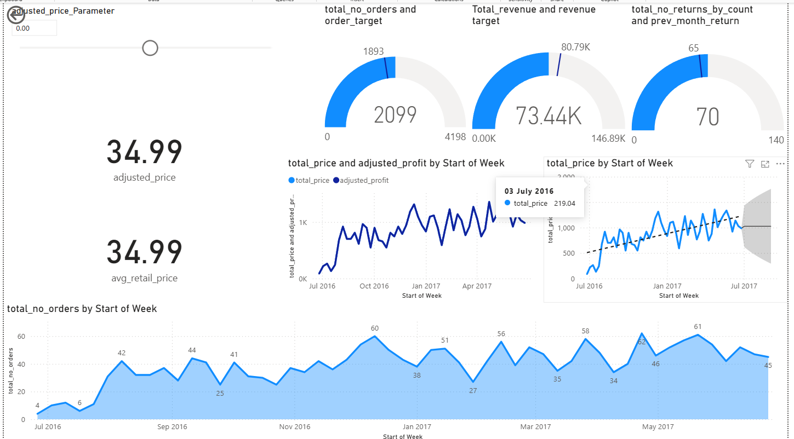
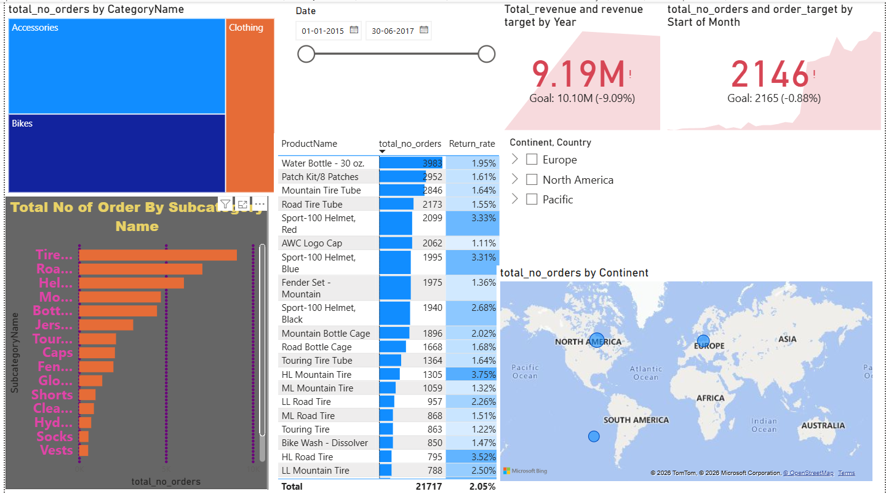

# Adventure Works Sales Analysis (Power BI)

An interactive Power BI report on Adventure Works sales data, covering order volume, revenue against targets, product and category performance, return rates, and regional distribution.

## Dashboard Preview

### Page 1: Weekly Performance and Pricing

- **Price what-if parameter**: a slider (`adjusted_price_Parameter`) that adjusts the price and recalculates `adjusted_price` against `avg_retail_price` (both show 34.99 at the default setting).
- **KPI gauges** comparing actuals to a benchmark:
  - Total orders vs order target (2,099 vs 1,893)
  - Total revenue vs revenue target (73.44K vs 80.79K)
  - Total returns vs previous month (70 vs 65)
- **Total price and adjusted profit by week**: line chart from July 2016 onwards.
- **Total price by week with trend line and forecast**: shows the upward trend and a forecast band beyond June 2017.
- **Total orders by week**: area chart with labelled highs and lows, peaking at around 60 orders per week.

### Page 2: Products, Categories and Regions

- **Orders by category**: treemap of Accessories, Bikes and Clothing.
- **Orders by subcategory**: bar chart ranking subcategories by order count.
- **Product table**: orders and return rate per product, with data bars. Total of 21,717 orders and a 2.05% overall return rate.
- **Revenue and order KPI cards**: total revenue of 9.19M vs a 10.10M goal (-9.09%), and 2,146 orders vs a goal of 2,165 (-0.88%).
- **Date slicer** (01-01-2015 to 30-06-2017) and **Continent / Country slicer** (Europe, North America, Pacific) that filter the page.
- **Map**: orders by continent.

## Key Insights

- **Weekly orders and revenue trend upward** from mid-2016 into 2017, with a forecast that levels off.
- **Revenue is behind target**: 9.19M against a 10.10M goal (-9.09%), while orders are very close to target (-0.88%).
- **Best-selling products** are low-priced accessories: Water Bottle - 30 oz. (3,983 orders), Patch Kit/8 Patches (2,952) and Mountain Tire Tube (2,846).
- **Return rates are highest on a few tyres and helmets**: HL Mountain Tire (3.75%), HL Road Tire (3.52%) and the Sport-100 Helmet in Red and Blue (about 3.3%), against a 2.05% overall rate.
- **Orders are concentrated** in North America and Europe.

## Tools and Techniques

- Power BI Desktop
- DAX measures (totals, targets, return rate, adjusted price and profit)
- What-if parameter
- Gauges, KPI cards, treemap, bar and area charts, tables with data bars, map visual
- Slicers, trend line and forecasting

## Files

| File                            | Description                               |
| ------------------------------- | ----------------------------------------- |
| `adventure_works analysis.pbix` | Power BI report                           |
| `screenshots/`                  | Dashboard page images used in this README |

## How to Open

1. Install [Power BI Desktop](https://powerbi.microsoft.com/desktop/) (free, Windows only).
2. Download the `.pbix` file from this repo.
3. Open it in Power BI Desktop.

## Author

Rakshit ([@Rakshiii365](https://github.com/Rakshiii365))
